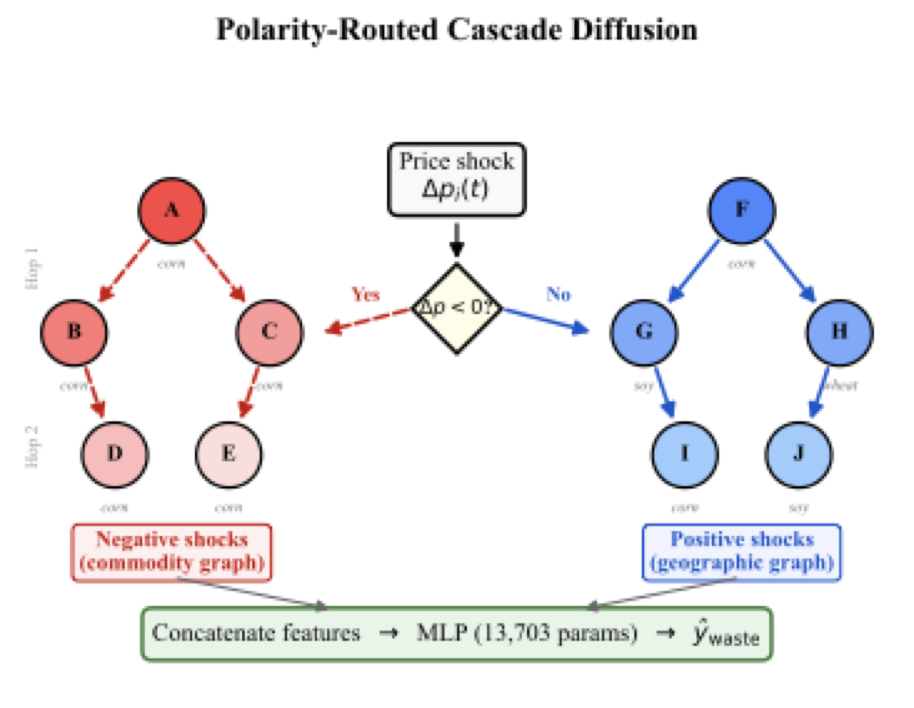

# CasCrop

**Crop waste forecasting that treats U.S. counties as one connected market. It predicts which
harvests will be abandoned by following price shocks through the supply chain.**



A county is not an island. When a bumper harvest in Iowa crashes corn prices, a farmer in Ohio
can walk away from a perfectly healthy corn crop because harvesting it now costs more than it
will sell for. Waste depends on biology and on economics, and the economics travel. Crop models
predict how much each county will produce, one county at a time. CasCrop predicts whether the
crop will be wasted, and it lets price shocks move between counties the way markets move them.

Crop waste costs U.S. agriculture roughly $19 billion a year in insurance indemnities alone.

```
USDA claims + NASS production + NOAA weather + futures prices
    ->  county-commodity-month panel (638,622 rows, 2,130 counties, 2015 to 2025)
    ->  two graph families: commodity networks and geographic adjacency
    ->  polarity routing: price drops spread on the commodity graph, gains on the geographic graph
    ->  multi-hop cascade features, joined to local biophysical and economic features
    ->  13,703-parameter MLP  ->  probability the crop goes unharvested
```

Surplus hurts competitors. Prosperity lifts neighbors.

## The core idea

Standard graph diffusion pushes every signal through one topology. Agricultural shocks do not
behave that way. They depend on their sign.

1. **Negative price shocks travel along commodity channels.** Oversupply in one county depresses
   prices for the same crop elsewhere. A corn glut in Iowa hurts corn counties in Ohio, not the
   wheat county next door.
2. **Positive signals travel through geography.** When regional prices rise, nearby counties
   benefit whatever they grow.

So CasCrop routes each shock through the graph that matches its polarity, then diffuses it one
and two hops out. A formal economic model in the paper shows that waste contagion comes from
market connectivity, and that positive and negative supply shocks have provably asymmetric
effects on neighboring regions.

The classifier is deliberately small. One 13,703-parameter MLP is held fixed across every
variant, so any difference in the results comes from the features, not from model size. It
trains in under a minute on a CPU.

## What it does (measured on 638,622 USDA records)

Five variants, each adding one component to the last. Mean of five seeds.

| Variant | Random split AUC-ROC | F1 | AP | Temporal split AUC-ROC |
|---|---|---|---|---|
| `local_only`: 19 biophysical + 3 historical features | 0.917 | 0.632 | 0.716 | **0.910** |
| `local_econ`: adds 8 economic features | 0.933 | 0.667 | 0.770 | 0.888 |
| `cascade_direct`: adds 20 cascade features on one combined graph | 0.927 | 0.655 | 0.750 | 0.904 |
| `symmetric_diff`: both shock signs through the same graph | 0.934 | 0.668 | 0.773 | 0.891 |
| **`polarity_routed`: shocks routed by sign (CasCrop)** | **0.935** | **0.669** | **0.775** | 0.892 |

On the random split, polarity routing is best on every metric: 0.935 AUC-ROC against 0.917 for
local features alone (p < 0.001) and against 0.934 for symmetric diffusion (p = 0.0002), using
bootstrap tests with 10,000 resamples and Bonferroni correction. Economic features account for
most of the lift, and average precision, the metric that matters most at an 18% waste rate,
rises from 0.716 to 0.775. Evaluation lives in `scripts/05_evaluate_all.py` and the tables are
generated by `scripts/08_generate_tables.py`.

## How it works

**Data.** 638,622 county-commodity-month observations for corn, soybeans, and wheat across 2,130
counties from 2015 to 2025. Labels come from USDA Risk Management Agency crop insurance claims.
Features come from USDA NASS production statistics, NOAA climate divisions (temperature,
precipitation, the Palmer drought index, degree days), FRED commodity futures, and Census county
adjacency. Every source is free and public.

**Graphs.** A geographic adjacency graph over all 2,130 counties, plus one commodity subgraph per
crop that connects only adjacent counties growing that crop. A corn shock can reach other corn
counties. It cannot leak into a neighboring wheat county.

**Features.** Each price shock is diffused one and two hops over the graph that matches its
polarity, then concatenated with the local biophysical and economic features. This follows the
simplified graph convolution line of work (SGC, SIGN): precompute the graph signal, then learn on
it with a plain model.

**Training.** Binary cross-entropy with a positive-class weight for the 18% waste rate, AdamW
(learning rate 1e-3, weight decay 1e-4), batch size 1024, early stopping on validation AUC-ROC,
and five seeds (42, 123, 456, 789, 1024).

**Evaluation.** A random 70/15/15 split stratified by label, and a temporal split that trains on
2015 to 2019, validates on 2020 to 2021, and tests on 2022 to 2024. AUC-ROC, F1 at the best
threshold, and average precision, each reported as mean and standard deviation across seeds.

## Run it

```bash
pip install -r requirements.txt
pip install -e .
python scripts/09_full_pipeline.py      # download, process, build graphs, train, evaluate, figures
```

Each stage also runs on its own, from `scripts/01_download_data.py` through
`scripts/08_generate_tables.py`. The `Dockerfile` reproduces the environment:

```bash
docker build -t cascrop . && docker run --gpus all cascrop
```

## Patent

A provisional patent application for polarity-routed cascade diffusion in crop waste forecasting
is in `patent/`, with the claims, the prior-art search, and a dated change log that documents the
invention.

## Layout

```
configs/               YAML config for each ablation row
src/
  data/                RMA, NASS, NOAA, price, soil, and imagery loaders; county matching; graph builder
  models/              cascade_net, prcn, cascrop, temporal variants, and every baseline
  models/graph/        graph construction, economic contagion message passing, graph attention
  models/encoders/     biophysical and economic encoders, disentanglement
  training/            training loop, losses, schedulers
  evaluation/          metrics, bootstrap significance tests, ablation runner, case study, economic impact
  visualization/       figures, maps, LaTeX tables
scripts/               00 to 09 pipeline, cascade and diffusion precompute, integration test
paper/                 manuscript, figures, tables
patent/                provisional application, claims, prior art, invention record
notebooks/             full experiment notebook
tests/                 loaders, graph construction, contagion layer, disentanglement, metrics, models
```

## Honesty

* The gain from routing is real and small. Most of the lift over local features comes from the
  economic features. Polarity routing beats symmetric diffusion by 0.001 AUC-ROC on the random
  split. That is statistically significant (p = 0.0002), but it is not large.
* On the temporal split, the local-only model wins (0.910 AUC-ROC) and every graph-augmented
  variant falls behind. Contagion patterns learned on 2015 to 2019 do not hold steady through
  2022 to 2024, so graph features would need regular retraining before anyone deploys them.
* The random split draws train and test from the same years. It shows the cascade features carry
  signal. It does not show they forecast the future.
* Labels are insurance claims. They record insured losses, not every acre left in the field.
* `src/models/` also holds earlier end-to-end graph attention variants. The paper's final method
  uses precomputed diffusion features with a small MLP, because at 2,130 counties the full graph
  networks did not earn their extra cost.

Apache 2.0.
